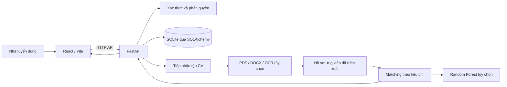
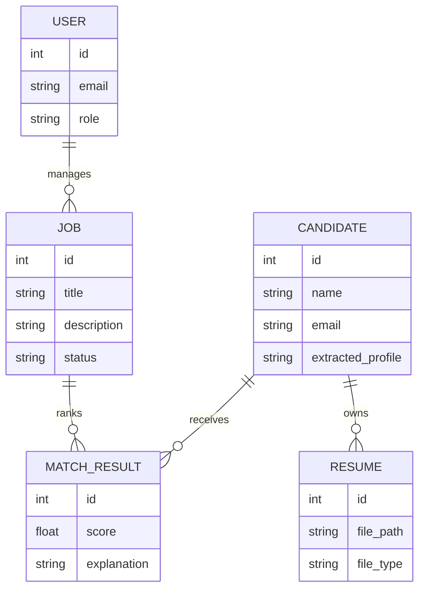

# BÁO CÁO ĐỒ ÁN TRÍ TUỆ NHÂN TẠO

## Trang bìa — thông tin cần xác nhận

**Trường:** [Xác nhận theo đơn vị đào tạo]  
**Khoa:** [Xác nhận]  
**Học phần/mã học phần:** [Xác nhận]  
**Tên đề tài:** Xây dựng trợ lý tuyển dụng ứng dụng trí tuệ nhân tạo  
**Sinh viên:** [Họ và tên]  
**Mã sinh viên:** [MSSV]  
**Lớp / ngành:** [Lớp / ngành]  
**Giảng viên hướng dẫn:** [Họ tên giảng viên]  
**Địa điểm, năm:** [Địa điểm, năm]

> Mẫu Overleaf của giảng viên là căn cứ bố cục. Những thông tin riêng của sinh viên và trường trong mẫu không được tự điền theo ví dụ.

## Lời cam đoan

[Chỉ giữ nội dung cam đoan sau khi sinh viên tự kiểm tra, chỉnh sửa cho đúng với quá trình thực hiện và ký xác nhận theo yêu cầu của trường.]

## Lời cảm ơn

[Viết lời cảm ơn cá nhân sau khi xác định giảng viên, đơn vị và những người đã hỗ trợ.]

## Tóm tắt

Đồ án xây dựng một ứng dụng hỗ trợ quy trình tuyển dụng, gồm quản lý vị trí tuyển dụng và hồ sơ ứng viên, đọc thông tin từ CV, tìm kiếm/matching ứng viên với công việc, và cung cấp giao diện theo dõi cho nhà tuyển dụng. Hệ thống được triển khai theo mô hình frontend–backend: giao diện React/Vite gọi API FastAPI; dữ liệu phát triển được lưu bằng SQLite. Bộ đọc hồ sơ tiếp nhận PDF và DOCX, trích xuất văn bản, sau đó nhận diện một số trường như thông tin liên hệ, kỹ năng, học vấn và kinh nghiệm. Với PDF dạng ảnh, hệ thống có nhánh OCR dự phòng khi môi trường có Tesseract và gói ngôn ngữ phù hợp.

Phần matching kết hợp các tín hiệu kỹ năng, kinh nghiệm, học vấn, dự án và tương đồng nội dung. Cấu hình hiện tại phân bổ trọng số lần lượt 40%, 15%, 15%, 10% và 20% cho các nhóm tín hiệu; khi bật embedding, phần tương đồng nội dung được chia giữa TF‑IDF và semantic similarity. Đồ án cũng huấn luyện mô hình Random Forest phân loại mức độ phù hợp từ dữ liệu đã chuẩn bị. Trên tập test tách theo hồ sơ ứng viên, mô hình đạt accuracy 0,7128 và macro F1 0,5645; baseline dự đoán lớp phổ biến đạt accuracy 0,7434 nhưng macro F1 0,2843. Kết quả cho thấy mô hình cải thiện cân bằng giữa các lớp theo macro F1, nhưng dữ liệu có nhãn hỗ trợ bằng mô hình và dữ liệu tổng hợp, nên kết quả hiện tại chỉ có ý nghĩa thử nghiệm, chưa đại diện cho đánh giá tuyển dụng thực tế. Semantic model không khả dụng trong lần đánh giá ghi ở báo cáo huấn luyện.

**Từ khóa:** tuyển dụng, phân tích CV, trích xuất thông tin, xếp hạng ứng viên, Random Forest.

## Mục lục

1. [Mở đầu](#1-mở-đầu)  
2. [Cơ sở lý thuyết và công nghệ](#2-cơ-sở-lý-thuyết-và-công-nghệ)  
3. [Phân tích và thiết kế](#3-phân-tích-và-thiết-kế)  
4. [Kết luận và hướng phát triển](#4-kết-luận-và-hướng-phát-triển)  
5. [Tài liệu tham khảo](#tài-liệu-tham-khảo)

# 1. Mở đầu

## 1.1. Lý do chọn đề tài

Quy trình tuyển dụng thường phải xử lý nhiều CV với định dạng và cách trình bày khác nhau. Việc nhập lại thông tin, đối chiếu từng hồ sơ với yêu cầu công việc và theo dõi trạng thái ứng viên có thể tốn thời gian. Đồ án chọn bài toán xây dựng trợ lý tuyển dụng nhằm kết hợp quản lý dữ liệu với các kỹ thuật trích xuất văn bản và xếp hạng ứng viên.

Hệ thống được định hướng là công cụ hỗ trợ người tuyển dụng tìm và xem xét hồ sơ. Điểm phù hợp do phần mềm tính toán không thay thế quyết định tuyển dụng của con người; thông tin trích xuất cần được kiểm tra lại trên CV gốc.

## 1.2. Mục tiêu của đồ án

- Xây dựng giao diện quản lý vị trí tuyển dụng, ứng viên, CV và kết quả matching.
- Tiếp nhận PDF/DOCX và trích xuất văn bản cùng một số trường thông tin phổ biến.
- Xây dựng điểm matching có thể giải thích theo nhóm tiêu chí.
- Thử nghiệm mô hình phân loại mức độ phù hợp và đánh giá trên tập dữ liệu tách riêng theo ứng viên.
- Đóng gói môi trường phát triển bằng Docker Compose và cung cấp API cho giao diện.

## 1.3. Phạm vi và đối tượng

Đối tượng sử dụng hướng tới là nhà tuyển dụng hoặc người quản lý quy trình tuyển dụng trong môi trường thử nghiệm. Phạm vi hiện tại tập trung vào CV PDF/DOCX, các trường thông tin văn bản phổ biến và một số nhóm tiêu chí matching. Độ chính xác phụ thuộc cấu trúc CV, chất lượng văn bản/OCR, từ điển kỹ năng và dữ liệu huấn luyện.

Ứng dụng chưa được kiểm chứng trên dữ liệu tuyển dụng đại diện quy mô lớn. Bộ dữ liệu đánh giá hiện có 93.733 bản ghi được tạo từ 643 hồ sơ và 351 mô tả công việc; nhãn có thành phần hỗ trợ bằng mô hình và dữ liệu tổng hợp. Vì vậy không diễn giải các chỉ số như bằng chứng về hiệu quả tuyển dụng ngoài thực tế.

## 1.4. Bố cục báo cáo

Chương 1 trình bày động cơ, mục tiêu và phạm vi. Chương 2 giới thiệu nền tảng xử lý CV, tìm kiếm văn bản, học máy và công nghệ triển khai. Chương 3 phân tích yêu cầu, kiến trúc, dữ liệu, mô hình, triển khai và đánh giá. Chương 4 tổng kết kết quả và nêu hướng phát triển.

# 2. Cơ sở lý thuyết và công nghệ

## 2.1. Kiến thức nền tảng

### 2.1.1. Trích xuất văn bản từ CV

PDF có thể chứa lớp văn bản hoặc chỉ có ảnh quét. Với PDF có văn bản, hệ thống dùng thư viện trích xuất để đọc nội dung; với tài liệu dạng ảnh có thể dùng OCR nếu Tesseract và dữ liệu ngôn ngữ được cài đặt. DOCX được đọc từ các đoạn văn bản của tài liệu. Kết quả trích xuất không đồng nghĩa với việc mọi trường đã được hiểu chính xác: bố cục nhiều cột, ký tự lỗi, bảng và thứ tự đọc có thể làm sai nội dung.

Sau bước đọc, bộ phân tích chuẩn hóa văn bản và dò các mẫu như email, số điện thoại, kỹ năng, mốc thời gian, học vấn và kinh nghiệm. Ngày tháng xuất hiện trong phần học vấn có thể bị nhầm là thời gian kinh nghiệm; do đó hệ thống cần dùng ngữ cảnh tiêu đề và phạm vi đoạn thay vì chỉ đếm năm. Các trường nhận diện được nên lưu kèm khả năng chỉnh sửa và đối chiếu với tài liệu gốc.

### 2.1.2. TF‑IDF và độ tương đồng cosine

TF‑IDF biểu diễn văn bản bằng trọng số từ, giảm ảnh hưởng của từ xuất hiện phổ biến và nhấn mạnh từ có tính phân biệt trong tài liệu. Độ tương đồng cosine giữa vector hồ sơ và mô tả công việc cung cấp tín hiệu tương đồng từ vựng. Cách này tương đối nhẹ, có thể chạy cục bộ, nhưng khó nhận ra từ đồng nghĩa nếu không có chuẩn hóa hoặc biểu diễn ngữ nghĩa.

### 2.1.3. Embedding ngữ nghĩa

Embedding ánh xạ văn bản thành vector để so sánh ý nghĩa gần nhau. Trong dự án, sử dụng embedding là cấu hình tùy chọn; khi không khả dụng, hệ thống có thể dựa trên TF‑IDF. Chất lượng so khớp phụ thuộc mô hình embedding, ngôn ngữ và cách tạo đầu vào. Không nên khẳng định chất lượng semantic nếu chưa bật và kiểm tra mô hình trong môi trường chạy.

### 2.1.4. Random Forest và đánh giá phân loại

Random Forest kết hợp nhiều cây quyết định được huấn luyện trên các mẫu và tập đặc trưng khác nhau. Đồ án dùng mô hình như một tín hiệu phân loại bổ sung cho mức phù hợp. Accuracy là tỷ lệ dự đoán đúng chung; macro F1 tính F1 từng lớp với trọng số bằng nhau, hữu ích khi số mẫu giữa các lớp không cân bằng. Chỉ số phụ thuộc cách chia dữ liệu và chất lượng nhãn.

## 2.2. Công cụ và thư viện

| Thành phần | Công nghệ trong dự án | Vai trò |
|---|---|---|
| Giao diện | React, Vite, React Router, Axios | Trang quản lý và gọi API |
| API | FastAPI, Pydantic | Endpoint, kiểm tra dữ liệu đầu vào/đầu ra |
| Truy cập dữ liệu | SQLAlchemy | Ánh xạ đối tượng và truy vấn |
| Cơ sở dữ liệu phát triển | SQLite | Lưu dữ liệu cục bộ |
| Tài liệu | pdfplumber/PyMuPDF, python-docx, Tesseract tùy chọn | Đọc PDF, DOCX và OCR dự phòng |
| Triển khai | Docker Compose | Khởi chạy frontend và backend trong môi trường phát triển |
| Học máy | scikit-learn và pipeline huấn luyện của dự án | TF‑IDF/Random Forest và đánh giá |

Các cổng cấu hình phát triển trong Compose là 5173 cho frontend và 8000 cho backend. `0.0.0.0` là địa chỉ bind bên trong dịch vụ; khi truy cập trên cùng máy, dùng `http://localhost:5173` hoặc `http://127.0.0.1:5173`, không nhập `http://0.0.0.0:8000` làm địa chỉ trang.

## 2.3. Các công trình liên quan

Phần này cần được hoàn thiện bằng các tài liệu học thuật do sinh viên tra cứu và xác minh theo yêu cầu trích dẫn của trường. Các chủ đề phù hợp gồm: (1) trích xuất thông tin từ sơ yếu lý lịch, (2) xếp hạng CV theo mô tả công việc, (3) đo lường thiên lệch và tính công bằng trong hệ thống tuyển dụng tự động. Không đưa tên bài báo hoặc số liệu nghiên cứu chưa kiểm chứng vào bản nộp.

# 3. Phân tích và thiết kế

## 3.1. Phân tích bài toán và yêu cầu

### 3.1.1. Quy trình nghiệp vụ

Nhà tuyển dụng đăng nhập, tạo vị trí với mô tả và tiêu chí, tải hồ sơ ứng viên lên, kiểm tra phần thông tin đã trích xuất, sau đó xem danh sách gợi ý/matching và chỉnh sửa dữ liệu khi cần. Hệ thống cần giữ liên kết giữa CV gốc, hồ sơ đã phân tích, vị trí và kết quả để người dùng có thể truy vết.

### 3.1.2. Yêu cầu chức năng

1. Xác thực người dùng và bảo vệ các thao tác quản trị.
2. Tạo, xem, sửa và quản lý trạng thái vị trí tuyển dụng.
3. Tải CV, lưu tệp và trích xuất thông tin ứng viên.
4. Cho phép rà soát, cập nhật trường trích xuất chưa đúng.
5. Tính và trình bày điểm matching cùng các thành phần liên quan.
6. Cung cấp dữ liệu tổng quan qua dashboard/API.

### 3.1.3. Yêu cầu phi chức năng

Giao diện cần phản hồi rõ trạng thái tải lên, lỗi đọc tệp và lỗi API. Tệp đầu vào phải được kiểm tra định dạng/kích thước theo cấu hình. Mật khẩu và token cần được xử lý an toàn; dữ liệu cá nhân trong CV cần được bảo vệ và chỉ dùng theo phạm vi được cho phép. Các kết quả tự động cần có khả năng rà soát bởi con người.

## 3.2. Thiết kế kiến trúc hệ thống

Frontend phụ trách tương tác; backend đảm nhiệm xác thực, nghiệp vụ, đọc CV, matching và truy cập dữ liệu. Tách lớp cho phép thay đổi giao diện hoặc mô hình mà không phải viết lại toàn bộ ứng dụng. Các router API được chia theo miền như xác thực, vị trí, ứng viên/CV, matching, dashboard và mô hình.

## 3.3. Thiết kế dữ liệu

Các thực thể nghiệp vụ chính gồm người dùng, vị trí tuyển dụng, hồ sơ ứng viên, tài liệu CV và kết quả matching. Một ứng viên có thể có tài liệu CV; một vị trí có thể được so khớp với nhiều ứng viên. Mỗi kết quả nên gắn với phiên bản dữ liệu và thời điểm tính toán để có thể giải thích và làm mới khi hồ sơ hoặc vị trí thay đổi.

> Sơ đồ khái niệm cần được đối chiếu với các model SQLAlchemy thực tế trước khi chuyển thành sơ đồ lược đồ vật lý trong bản PDF cuối.

## 3.4. Thiết kế mô hình và thuật toán

### 3.4.1. Bộ phân tích CV

Luồng phân tích gồm kiểm tra loại tệp, trích xuất nội dung, chuẩn hóa văn bản, nhận diện trường và trả kết quả có thể chỉnh sửa. PDF văn bản và PDF scan có đường xử lý khác nhau; OCR là phương án dự phòng phụ thuộc cấu hình môi trường. Khi văn bản rỗng hoặc quá ít, hệ thống nên báo cho người dùng biết thay vì tạo hồ sơ có vẻ đầy đủ nhưng thiếu căn cứ.

Các nhóm thông tin mục tiêu gồm liên hệ, kỹ năng, học vấn, kinh nghiệm, dự án, chứng chỉ và ngôn ngữ. Nhận diện thời gian cần xét tiêu đề và ngữ cảnh khối nội dung để không cộng năm học vào số năm kinh nghiệm. Những kết quả chưa chắc chắn cần để trống hoặc gắn cờ rà soát, không tự suy diễn.

### 3.4.2. Tính điểm matching

Cấu hình điểm hiện tại dùng các nhóm sau:

| Tín hiệu | Trọng số cấu hình |
|---|---:|
| Kỹ năng | 40% |
| Kinh nghiệm | 15% |
| Học vấn | 15% |
| Dự án | 10% |
| Tương đồng nội dung | 20% tổng |

Khi semantic được bật, phần tương đồng nội dung chia thành TF‑IDF 10% và semantic 10%; khi tắt, TF‑IDF chiếm 20%. Lần đánh giá model nêu tại mục 3.6 ghi semantic model không khả dụng. Đây là các trọng số cấu hình, không phải kết quả đã tối ưu bằng một thử nghiệm người dùng. Các thành phần cần được hiển thị đủ rõ để nhà tuyển dụng biết vì sao ứng viên được xếp hạng.

### 3.4.3. Mô hình Random Forest

Tập dữ liệu huấn luyện được chuẩn bị thành 93.733 bản ghi, gồm 643 hồ sơ ứng viên duy nhất và 351 mô tả công việc. Chia train/validation/test theo ứng viên để hạn chế cùng một ứng viên xuất hiện ở nhiều tập: lần lượt 65.419, 14.386 và 13.928 bản ghi; seed 42. Đây vẫn là dữ liệu tổng hợp/model-assisted, nên cách chia theo ứng viên không loại bỏ khả năng lệch nguồn hoặc nhiễu nhãn.

## 3.5. Cài đặt và triển khai

Mã nguồn chia thành frontend và backend. Trong thiết lập phát triển dự án, Docker Compose khởi chạy API và giao diện ở các cổng cấu hình tương ứng. SQLite được dùng làm cơ sở dữ liệu phát triển. Cấu hình chạy cục bộ có thể thay đổi theo file môi trường; không ghi giá trị bí mật thật vào báo cáo hoặc kho mã.

Quy trình chạy cần đối chiếu với README và file Compose tại thời điểm nộp. Sau khi khởi động, kiểm tra trang frontend qua `http://localhost:5173` và tài liệu API FastAPI qua `http://localhost:8000/docs`. Trên Docker Desktop, cần bảo đảm container khỏe và URL API mà trình duyệt dùng có thể truy cập được từ máy host.

## 3.6. Thử nghiệm và đánh giá

### 3.6.1. Thiết lập đánh giá

Báo cáo huấn luyện trong `data/training/evaluation_report.md` ghi nhận phép chia dữ liệu theo hồ sơ ứng viên, seed 42. So sánh mô hình Random Forest với baseline dự đoán lớp chiếm đa số. Các chỉ số tổng hợp được ghi lại dưới đây; cần chạy lại pipeline trên đúng phiên bản dữ liệu/mã nộp và lưu log nếu giảng viên yêu cầu khả năng tái lập.

| Chỉ số | Random Forest | Majority baseline |
|---|---:|---:|
| Accuracy | 0,7128 | 0,7434 |
| Macro precision | 0,5422 | — |
| Macro recall | 0,6148 | — |
| Macro F1 | 0,5645 | 0,2843 |
| Weighted F1 | 0,7344 | 0,6340 |

Accuracy của Random Forest thấp hơn baseline lớp đa số; macro F1 cao hơn, cho thấy khả năng cân bằng giữa các lớp tốt hơn theo chỉ số này. Kết quả chưa chứng minh mô hình phù hợp để tự động ra quyết định tuyển dụng. Cần bổ sung kiểm định trên dữ liệu thật đã được gán nhãn độc lập, phân tích theo nhóm và đánh giá sai số của bộ đọc CV.

### 3.6.2. Kiểm tra phần mềm

Kho mã có các bộ kiểm tra cho bộ phân tích CV, thành phần cốt lõi, pipeline huấn luyện và dịch vụ embedding. Trạng thái chạy tại thời điểm hoàn thiện báo cáo: **[CẦN CHẠY VÀ GHI KẾT QUẢ trên đúng môi trường nộp]**. Không ghi “đạt toàn bộ” cho đến khi lưu kết quả chạy thực tế; cần bổ sung phiên bản Python/Node, lệnh kiểm tra, số ca đạt/thất bại và lỗi còn tồn tại.

### 3.6.3. Hạn chế và rủi ro

- Dữ liệu tổng hợp và nhãn có hỗ trợ bằng mô hình làm giới hạn tính đại diện.
- Tài liệu có bố cục phức tạp, scan kém hoặc OCR thiếu ngôn ngữ có thể trích xuất sai.
- Nhận diện kỹ năng dựa vào văn bản/từ khóa có thể bỏ sót cách diễn đạt tương đương.
- Điểm phù hợp có thể phản ánh thiên lệch trong dữ liệu hoặc tiêu chí tuyển dụng.
- Dữ liệu CV là dữ liệu cá nhân; cần có quyền xử lý, kiểm soát truy cập và thời hạn lưu phù hợp.
- Điểm số chỉ hỗ trợ sàng lọc, không nên là căn cứ duy nhất để từ chối ứng viên.

# 4. Kết luận và hướng phát triển

Đồ án hiện thực hóa một nguyên mẫu trợ lý tuyển dụng gồm giao diện quản lý, API backend, lưu trữ dữ liệu, đọc CV và tính matching. Hệ thống kết hợp quy tắc trích xuất, độ tương đồng văn bản và mô hình Random Forest. Kết quả đánh giá ghi nhận macro F1 của Random Forest cao hơn baseline lớp đa số, nhưng accuracy thấp hơn; đồng thời dữ liệu thử nghiệm chưa đủ đại diện để kết luận hiệu quả trong tuyển dụng thật.

Hướng phát triển gồm thu thập dữ liệu có sự đồng ý và gán nhãn độc lập; đánh giá riêng độ chính xác từng trường trích xuất; cải thiện nhận diện bố cục và ngữ cảnh thời gian; bổ sung giải thích điểm matching; kiểm tra thiên lệch và bảo vệ dữ liệu; hoàn thiện kiểm thử tích hợp và triển khai. Trước khi nộp, cần điền thông tin bìa, xác nhận phần cam đoan, thêm tài liệu tham khảo học thuật, chạy lại kiểm tra và đối chiếu từng hình/bảng với bản mã cuối.

# Tài liệu tham khảo

1. **[Cần bổ sung]** Tài liệu học thuật về trích xuất thông tin từ CV/sơ yếu lý lịch.
2. **[Cần bổ sung]** Tài liệu học thuật về xếp hạng hồ sơ ứng viên hoặc information retrieval.
3. **[Cần bổ sung]** Tài liệu học thuật về công bằng, thiên lệch và đánh giá hệ thống tuyển dụng tự động.
4. Tài liệu thư viện/framework chỉ đưa vào danh mục nếu báo cáo chính thức trích dẫn hoặc yêu cầu của khoa.

---

**Checklist trước khi chuyển sang bản nộp:** xác nhận biểu mẫu trường và thông tin sinh viên; hoàn thiện cam đoan/cảm ơn; thêm trích dẫn học thuật; cập nhật sơ đồ dữ liệu từ model thật; chạy lại test và pipeline để xác nhận số liệu; định dạng nội dung vào template XeLaTeX của giảng viên rồi biên dịch, kiểm tra PDF.
